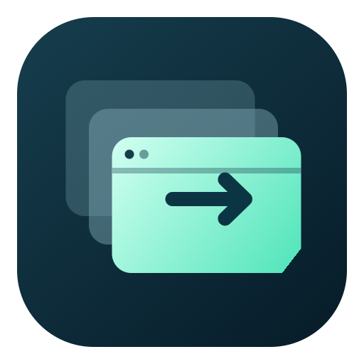
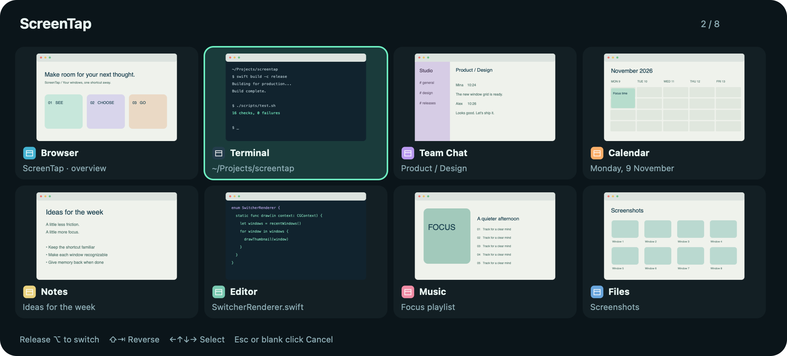

<p align="center"></p>
<h1 align="center">ScreenTap</h1>
<p align="center">창은 한눈에. 전환은 한 번에.<br>See your windows. Keep your flow.</p>
<p align="center">Native macOS · Swift + AppKit · MIT License · 한국어 / English</p>



> 앱과 동일한 렌더러로 만든 화면이며, 창 내용은 공개용 데모입니다. 개인 화면이나 메시지는 포함하지 않습니다.

ScreenTap은 개별 창 미리보기와 최근 사용 순서를 제공하는 macOS 창 전환기입니다. LeanTab에서 이름을 바꿨으며, 외부 런타임 패키지 없이 Apple 프레임워크로 실행됩니다. 검색과 전체 크기 미리보기 대신 작은 썸네일과 창 전환에 집중합니다.

[다운로드](https://github.com/peses0326/sreen-tap_for_mac/releases/latest) · [랜딩페이지 소스](site/index.html) · [라이선스](LICENSE) · [출처](NOTICE.md)

## 설치와 실행

1. Releases에서 `ScreenTap-macOS-arm64.zip`을 내려받아 압축을 풉니다.
2. `ScreenTap.app`을 응용 프로그램 폴더로 옮긴 다음 실행합니다. 메뉴 막대에 창과 화살표 아이콘이 나타납니다.
3. 시스템 설정 → 개인정보 보호 및 보안 → **손쉬운 사용**에서 ScreenTap을 허용합니다.
4. **화면 및 시스템 오디오 녹음**에서도 허용합니다. 실제 오디오는 캡처하지 않습니다.
5. 권한 안내의 상태는 설정 중 자동으로 갱신됩니다. 이미 허용했는데도 대기 중이면 안내창의 **앱 재시작**을 사용합니다. macOS가 새 프로세스에서 권한을 반영해야 할 수 있습니다.
6. 기존 AltTab 등 같은 단축키를 사용하는 앱을 종료하거나 단축키를 변경합니다.
7. 필요한 경우 앱을 다시 실행하거나 메뉴의 ‘권한 설정 / 다시 연결’을 사용합니다.

Apple Silicon, macOS 14 이상이 필요합니다. 실제 실행 검증 환경은 macOS 26.6입니다. 현재 개인용 배포 빌드는 ad-hoc 서명이며 Developer ID 서명·공증은 포함하지 않았습니다. macOS의 보안 안내를 확인한 뒤 직접 열거나 공개 소스에서 빌드할 수 있습니다.

기존 LeanTab 사용자는 기존 앱을 먼저 종료한 뒤 `ScreenTap.app`을 실행합니다. 앱 식별자는 연속성을 위해 유지했으나, 재빌드나 설치 경로 변경 시 macOS 권한을 다시 허용해야 할 수 있습니다.

## 조작

| 조작 | 동작 |
|---|---|
| ⌥Tab | 최근 사용한 개별 창 순서로 이동 |
| ⌥⇧Tab | 역순 이동 |
| ⌥ 놓기 | 선택한 창 활성화 |
| 방향키 | 격자 선택, 페이지 자동 이동 |
| Return / 창 클릭 | 선택한 창 활성화 |
| Esc / 여백 클릭 / 우클릭 | 창 전환 없이 닫기 |
| ⌘W / ⌘M | 선택 창 닫기 / 최소화 |
| 메뉴 → 창 전환기 열기 | ⌥를 계속 누르지 않고 열기 |
| 메뉴 → 언어 | 시스템 언어 / 한국어 / 영어 |

전환기 안쪽 여백이나 바깥 화면을 클릭하면 취소합니다. 이 클릭은 뒤쪽 앱에 전달되지 않으며, 이후 Option을 놓아도 창이 전환되지 않습니다.

같은 앱의 여러 창을 각각 나열합니다. 최근 사용 순서는 앱 실행 이후 관찰한 포커스 이벤트로 정하며, 관찰하지 못한 창은 현재 화면의 겹침 순서를 우선 사용합니다. AX가 제공하는 숨김·최소화·다른 Space의 창도 포함합니다. 이미지를 얻지 못한 창은 아이콘으로 표시합니다.

## 메모리 설계

- 전환기가 열릴 때 현재 페이지의 창(최대 12개)만 순차 캡처합니다.
- 최대 480×300픽셀로 요청하고, OS가 더 큰 이미지를 반환해도 작은 비트맵으로 축소합니다.
- 이미지 캐시 상한은 **12MiB**이며, 전환기를 닫으면 캐시·격자·아이콘·패널 참조를 해제합니다.
- 빠른 페이지 이동과 재실행에서도 OS 캡처 요청을 동시에 하나만 유지합니다.
- 대기 중 주기적 캡처·타이머를 사용하지 않고, 접근성·앱 활성화 이벤트를 구독합니다.
- OS 메모리 압력 경고에서도 캐시를 비웁니다.

캐시 상한은 앱 전체 메모리 상한이 아닙니다. AppKit·ScreenCaptureKit·WindowServer·GPU 내부 할당은 별도입니다. 진행 중 OS 요청은 해당 콜백이 돌아올 때 해제됩니다.

### 확인한 측정값

macOS 26.6(25G72), 이름 변경 전 **LeanTab 0.1.1**에서 사용자가 확인한 실제 진단입니다.

| 측정 항목 | 결과 |
|---|---:|
| 마지막 캡처 시점 프로세스 메모리 | 134.8MiB |
| 전환기 종료 후 프로세스 메모리 | 43.1MiB |
| 종료 후 썸네일 캐시 | 0바이트 |
| 페이지 요청 / 매칭 / 캡처 성공 / 실패 | 12 / 12 / 12 / 0 |

전체 실행 시간의 피크나 ScreenTap 0.2.0의 새로운 성능 측정은 아닙니다. 장시간 반복 사용과 동일 부하에서의 AltTab 비교는 아직 측정하지 않았습니다. 0.1.1의 실제 썸네일 표시와 여백 클릭 취소는 사용자 확인을 받았습니다. 0.2.0은 자동 검사 18개, 릴리스 빌드, 패키지 서명 검증으로 확인하며 GUI 실행 확인과 구분합니다.

## 빌드와 검사

macOS 26 SDK가 있는 Command Line Tools 또는 Xcode가 필요합니다. 패키지의 최소 실행 버전은 macOS 14입니다.

```sh
./scripts/test.sh
./scripts/build.sh
open dist/ScreenTap.app
```

전체 Xcode가 없는 환경도 검사할 수 있도록 독립 실행형 `CoreChecks`를 사용합니다. 앱과 마케팅 이미지가 공유하는 렌더러의 픽셀 출력과 macOS의 ICNS 디코딩도 검사합니다.

```sh
# 아이콘과 공개용 데모 이미지를 다시 생성
./scripts/build-assets.sh

# ZIP 배포 파일과 SHA256 체크섬 생성
./scripts/package.sh

# 선택: 디스크 이미지 생성이 가능한 macOS 환경에서 DMG도 생성
./scripts/package.sh --dmg
```

기본 서명은 개인 사용용 ad-hoc 서명입니다. 본인의 안정적인 서명 인증서가 있으면 `SIGN_IDENTITY` 환경 변수로 지정할 수 있습니다.

## GitHub 배포

이 저장소는 다음 흐름을 포함합니다.

- `check.yml`: 핵심 검사, 앱 빌드, 랜딩페이지 정적 검증.
- `pages.yml`: `site/`를 GitHub Pages에 배포.
- `release.yml`: 수동 실행 시 검증·패키징 후 GitHub Release 생성.

공개 업로드 도우미는 로그인 계정을 확인하고 공개 저장소를 생성하거나 기존 공개 저장소를 재사용합니다. 다른 저장소를 덮어쓰거나 강제 푸시하지 않습니다. 설치 ZIP·체크섬을 릴리스에 올리고 Pages 배포를 요청합니다.

```sh
# 본인의 터미널에서 GitHub 인증이 필요한 경우
 gh auth login --hostname github.com --git-protocol https --web

# 커밋된 소스와 패키지를 peses0326/sreen-tap_for_mac에 공개
./scripts/publish-github.sh
```

## 범위와 출처

AltTab의 개별 창 전환 개념에서 영감을 받은 독립 구현입니다. 원본 전체 기능과의 동등성이 검증된 포크가 아니며 원본 코드·이미지를 복사하지 않았습니다. 조사 범위는 [설계와 근거](docs/architecture.md)에 기록했습니다.

다른 Space·전체 화면·최소화 창의 정확한 활성화는 앱과 macOS 버전에 따라 추가 검증이 필요합니다. 앱별 제외 규칙, 탭 그룹화, 단축키 사용자 지정, 로그인 시 실행, 자동 업데이트는 포함하지 않았습니다.

AX 창과 캡처 창의 정확한 연결을 위해 `_AXUIElementGetWindow` 비공개 함수를 선택적으로 사용하며 `WindowService.swift`에 격리했습니다. 실패 시 `AXWindowNumber`를 시도하고, 둘 다 실패하면 해당 창을 제외합니다. Mac App Store 배포를 목표로 한 구현은 아닙니다.

## 저작권과 라이선스

Copyright © 2026 **peses0326**. [MIT License](LICENSE).

오픈소스 공개는 저작권 양도가 아닙니다. 다른 사람에게 라이선스 조건에 따른 사용·수정·배포 권한을 제공합니다. AltTab과 제3자의 권리는 각각의 소유자에게 있으며, 그 코드를 향후 포함한다면 해당 라이선스를 준수해야 합니다. [NOTICE.md](NOTICE.md) 참조.

## 권한 요청 흐름 (0.2.2)

- 앱 확인 시트의 **허용**은 파란 기본 버튼이며 **거부**는 요청을 보내지 않습니다.
- 첫 허용 시 실제 macOS 권한 요청을 보냅니다. 화면 기록은 ScreenCaptureKit의 캡처 가능 콘텐츠 조회, 접근성은 AX 권한 요청을 사용합니다.
- 설정 중에는 창 목록 메타데이터만 조회하며 스크린샷·오디오·연속 스트림은 캡처하지 않습니다.
- 네이티브 요청 뒤에 앱이 설정 URL까지 자동으로 열지 않습니다. OS 팝업에서 직접 진행하거나, 앱의 후속 **설정 열기** 버튼을 사용합니다. 이 버튼은 네이티브 요청을 반복하지 않습니다.
- **앱 위치 보기**는 현재 실행 중인 앱을 Finder에서 선택합니다. 설정 목록에 앱이 보이지 않을 때 + 버튼으로 해당 앱을 추가할 수 있습니다.
- 실제 승인은 macOS가 관리합니다. 앱의 안내 시트만으로 권한이 부여되지는 않으며, macOS 자체 팝업의 문구나 버튼을 앱이 바꿀 수는 없습니다.
- 권한 안내가 보이는 동안만 0.5초 간격으로 상태를 확인합니다. 안내를 닫으면 타이머를 멈춥니다. 설정 앱에서 돌아왔을 때도 상태를 확인합니다.
- 접근성 승인 시 창 추적과 단축키를 연결합니다. 실행 중 권한 회수 시 해제하고, 다시 허용되면 재연결합니다.
- 이미 허용했는데 반영되지 않으면 **앱 재시작**으로 새 프로세스를 실행합니다.

0.2.1에서는 중복 설정창을 줄이는 과정에서 실제 OS 요청을 제거한 문제가 있었습니다. 0.2.2는 실제 요청과 사용자가 선택하는 설정 열기를 분리해 이를 수정합니다.
